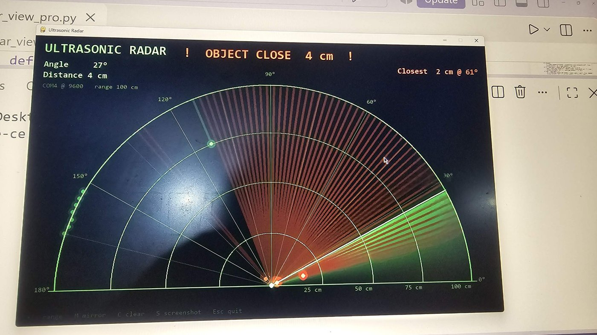
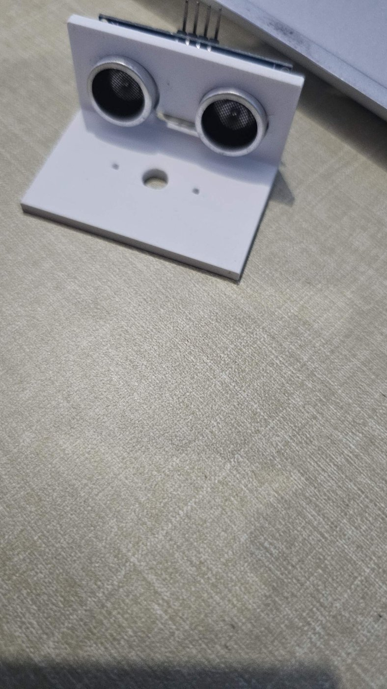
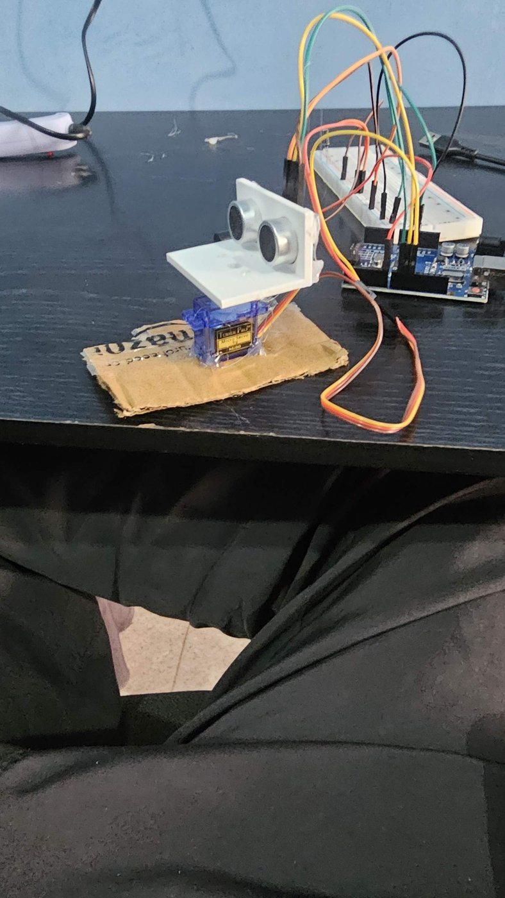
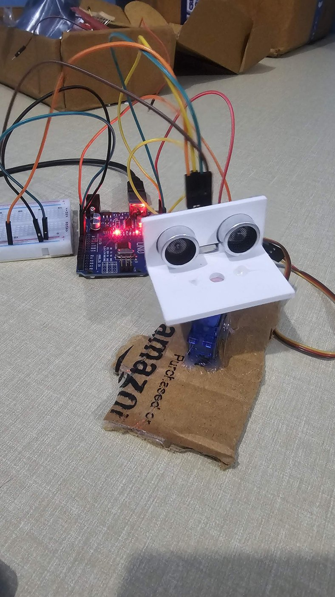
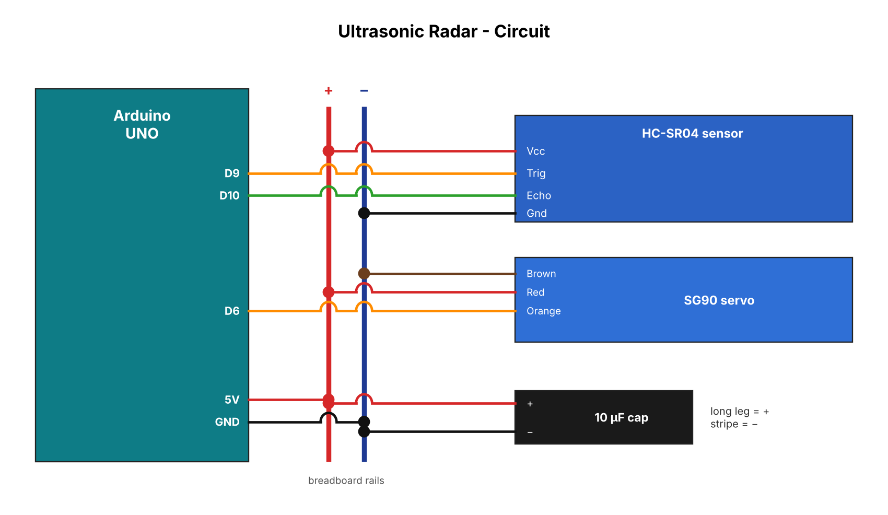
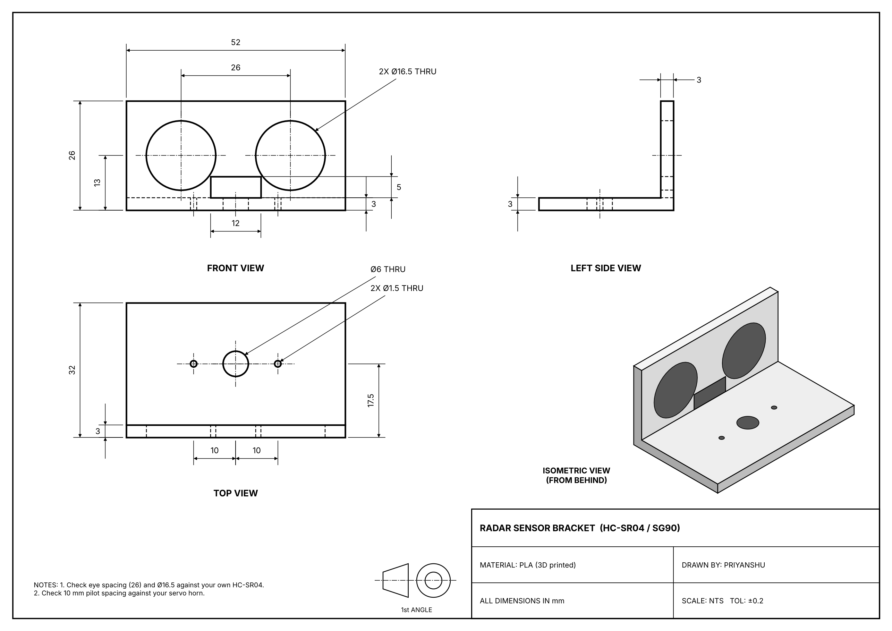
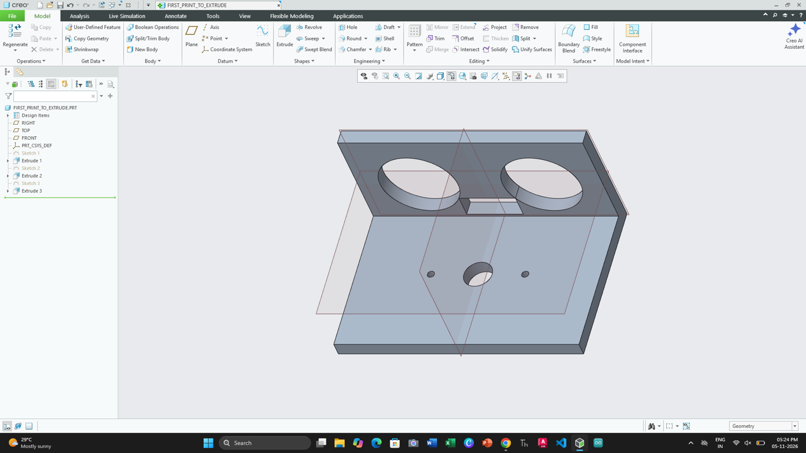

# 02 - Ultrasonic Radar 📡

A sweeping ultrasonic radar: an HC-SR04 sensor rides on an SG90 servo using a **custom bracket I designed in PTC Creo and 3D-printed**. The Arduino sweeps 15°–165°, measures distance at each angle, and a Python app draws a live radar screen.



## Demo video
<!-- Upload the video: on github.com open this README → ✏️ Edit → drag demo.mp4 into this spot → Commit.
     GitHub turns it into an inline player. -->
https://github.com/priyanshudevcodes/hardware-projects/blob/main/02-ultrasonic-radar/media/demo.mp4

## The build
| Printed bracket + sensor | Mounted on the servo | Full setup |
|---|---|---|
|  |  |  |

## Parts
- Arduino UNO R3, breadboard, jumper wires (Electrobot EB-KIT-020)
- HC-SR04 ultrasonic sensor
- SG90 micro servo
- 10 µF capacitor across 5V/GND (steadies the servo)
- 3D-printed bracket (PLA), fixed to the servo horn with hot glue

## Circuit


| Component | Pin | Arduino |
|---|---|---|
| HC-SR04 | Vcc / Gnd | 5V / GND (breadboard rails) |
| HC-SR04 | Trig / Echo | D9 / D10 |
| SG90 servo | Red / Brown | 5V / GND (breadboard rails) |
| SG90 servo | Orange (signal) | D6 |
| 10 µF cap | + / − | 5V / GND rails (stripe = −) |

## 3D-printed bracket (Creo → Bambu)
Designed in **PTC Creo Parametric** using only **Sketch + Extrude** (3 features):
1. Front wall 52 × 26 × 3 mm with two Ø16.5 eye holes and a 12 × 5 crystal slot
2. Base plate 52 × 32 × 3 mm
3. Servo holes: Ø6 center + 2× Ø1.5

| Drawing | Creo model |
|---|---|
|  |  |

**Printed on Bambu Lab P1S:** PLA, 0.20 mm, 15 % infill, 3 walls, no supports, eye-hole face down, X-Y hole compensation 0.15 mm. ~26 min, 8.5 g.

Files: `cad/radar_mount_02.stl` (print) · `cad/radar_mount_02.3mf` (Bambu Studio project)

## How to run
```bash
# 1. Arduino: open radar/radar.ino in Arduino IDE → Upload
#    (set CENTER_MODE = true once to hold 90° while mounting the bracket)

# 2. Close the Arduino Serial Monitor, then:
pip install -r requirements.txt
python radar_view_pro.py COM4      # your port
python radar_view_pro.py demo      # try it without hardware
```
Keys: `+/-` range · `M` mirror · `C` clear · `S` screenshot · `Esc` quit

## Repo layout
```
02-ultrasonic-radar/
├── radar/radar.ino          Arduino sketch (servo sweep + distance over serial)
├── radar_view_pro.py        pygame radar screen
├── requirements.txt
├── cad/                     STL, Bambu project, drawing, Creo screenshots
├── docs/                    circuit diagram, glue guide, slicer setup
└── media/                   photos + demo video
```

## Lessons learned
- **Creo sketcher:** touching/intersecting entities block a solid extrude; *Overlapping Geometry* and *Resolve Sketch* show the culprit (a hidden "point on entity" constraint here).
- **STL export:** default tessellation turned Ø16.5 holes into polygons; lower chord height / raise angle control.
- **Bambu "Lay on Face":** check the size readout; my first slice was balanced on two edges.
- **Breadboard rails:** servo hummed and sensor read `-1` until the 5V/GND rails were wired properly.
- **Extrude direction:** the base came out on the sensor side instead of behind it; it still works fine.

## Known issues / v2 ideas
- Dropped the buzzer alert (kit buzzer didn't respond); the screen shows a flashing *OBJECT CLOSE* warning instead.
- Next: LCD1602 readout, faster sweep, servo base designed in Creo instead of cardboard.
