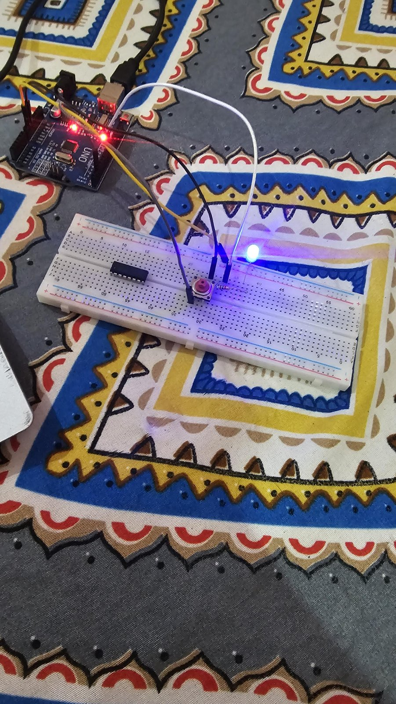
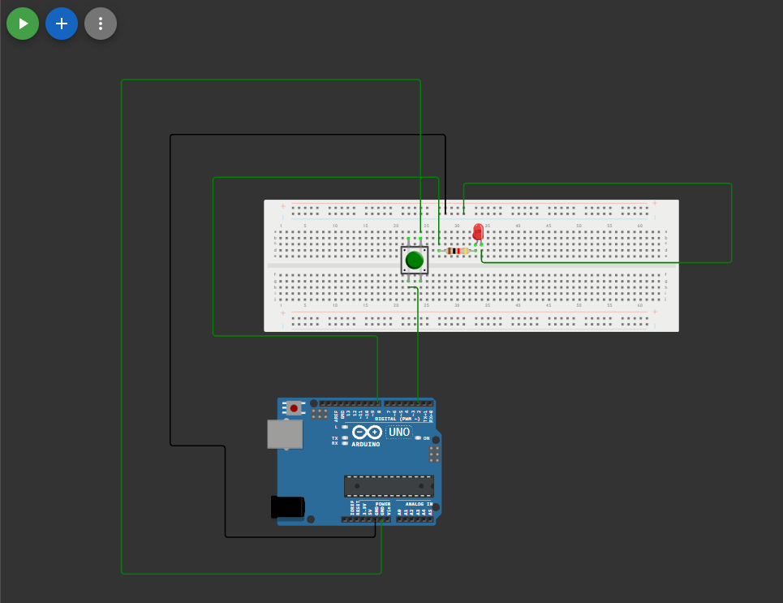

# 01 · Button LED Toggle

Press the button once → LED turns **ON**. Press again → LED turns **OFF**.

## Real circuit

## Circuit diagram (Wokwi)

▶ **Try it in the browser (Wokwi simulation):** [Open simulation](PASTE-YOUR-WOKWI-LINK-HERE)

---

## Parts
| Part | Qty |
|---|---|
| Arduino Uno R3 | 1 |
| Breadboard | 1 |
| Push button | 1 |
| Blue LED | 1 |
| 1kΩ resistor (brown–black–red–gold) | 1 |
| Jumper wires | 4–5 |

## Wiring
| From | To |
|---|---|
| Pin 2 | Button (one leg) |
| Button (diagonal leg) | GND |
| Pin 8 | 1kΩ resistor |
| Resistor (other end) | LED long leg (anode, +) |
| LED short leg (cathode, –) | GND |

No extra resistor is needed for the button, because the code uses the Arduino's internal pull-up (`INPUT_PULLUP`).

## How the code works
- **`INPUT_PULLUP`** keeps pin 2 at HIGH normally. Pressing the button connects it to GND, so it reads LOW.
- **Edge detection:** the LED only toggles at the moment the button goes from HIGH → LOW (just pressed), not the whole time it's held down.
- **Debounce:** a 50 ms delay ignores the tiny electrical "bounces" a mechanical button makes when pressed.

## Problems I fixed
**On the real breadboard:**
- LED wire was in the wrong Arduino pin (not pin 8)
- LED was inserted backwards (long leg must face the resistor / pin side)
- Breadboard power rail is split in the middle, so GND wasn't reaching the LED

**In the Wokwi simulation:**
- Missing variable declarations caused a build error
- LED anode (A) and cathode (C) were swapped

## What I learned
- How breadboard rows, columns and split power rails connect
- LED polarity matters: current only flows from anode to cathode
- Using internal pull-up resistors for buttons
- Detecting a button press (edge) instead of a held state
- Simulating and debugging circuits in Wokwi before building them

## Demo video
<!-- Drag and drop the video file here in the GitHub editor -->
